**# Threat Hunt Report: Wrong Shell (Compromised Workstation NL-WS01)**

\- **\*\*Cyber Range Community Threat Hunt 195\*\***

\- **\*\*Host / user:\*\*** \`NL-WS01\` / \`sarah.cole\`

\- **\*\*Hunt window:\*\*** 2026-10-15, 10:00-17:00 UTC

\- **\*\*Workspace:\*\*** \`LAW-HuntPractice\` (Azure Log Analytics)

\- **\*\*Result:\*\*** 30 of 30 flags solved, 2,275 / 2,275 points

\- **\*\*Analyst:\*\*** [Your name]

**## Platforms and Languages Leveraged**

\- Microsoft Azure, Log Analytics workspace (\`LAW-HuntPractice\`)

\- Sysmon logs and Windows Security event logs (custom \`\_CL\` tables)

\- Kusto Query Language (KQL)

\- Cyber Range hunt platform (flags, hints, case file)

\- MITRE ATT&CK

**## Scenario**

The SOC received two reports on the morning of 2026-10-15. An IT administrator saw unusual outbound HTTP traffic from workstation \`NL-WS01\`, with repeated connections to an unfamiliar domain. Separately, the workstation's user, \`sarah.cole\`, reported a suspicious email branded as Netflix. The outbound traffic was still active at handover.

The goal was to identify the process behind the traffic, trace it back to how it arrived, and trace it forward to what it did.

**### High-Level Hunt Plan**

\- Check \`SysmonNetwork_CL\` for the outbound traffic the administrator flagged.

\- Check \`SysmonProcess_CL\` for the parent process and the commands typed by the operator.

\- Check \`SysmonFileCreate_CL\` for files written to disk (dropped and persistent files).

\- Check \`SysmonRegistryEvent_CL\` for persistence (Run keys).

\- Check \`SecurityEvent_CL\` for logons and for any group or rights changes.

**## Steps Taken**

**### 1. Fixed the Time Column**

My first queries for 15 October returned no rows, even though the tables had data. Checking the oldest \`TimeGenerated\` value showed it started on 2026-10-18, **\*\*after\*\*** the incident, so in these lab tables \`TimeGenerated\` is the upload time. Listing the columns showed a second datetime column, \`OriginalTime\`, which holds the real event time. Every query after this one filters on \`OriginalTime\`.

**\*\*Queries used to locate the problem and the fix:\*\***

\`\`\`kql

SysmonNetwork_CL

\| where TimeGenerated > ago(730d)

\| summarize min(TimeGenerated), max(TimeGenerated), count()

\`\`\`

\`TimeGenerated\` starts on 2026-10-18, after the incident.

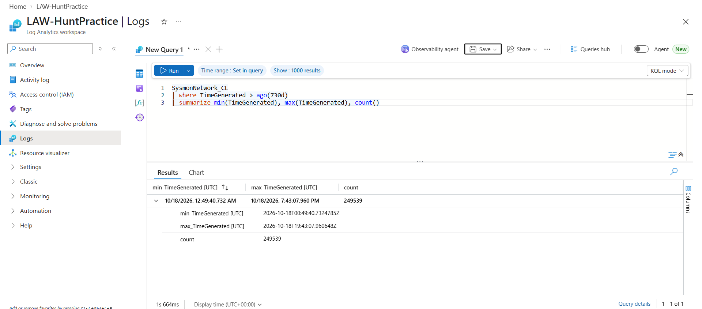

\`\`\`kql

SysmonNetwork_CL

\| getschema

\| project ColumnName, ColumnType

\`\`\`

The column list shows a second datetime column, \`OriginalTime\`.

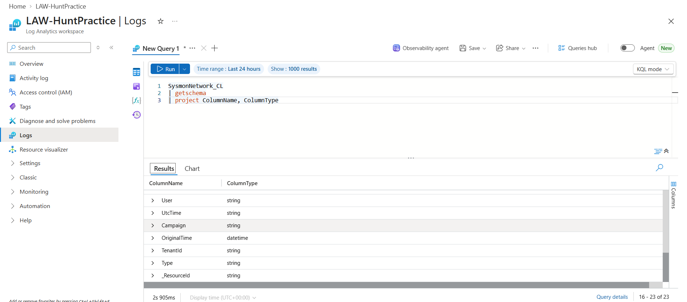

\`\`\`kql

SysmonNetwork_CL

\| where TimeGenerated > ago(730d)

\| summarize min(OriginalTime), max(OriginalTime), count()

\`\`\`

\`OriginalTime\` ranged from 2026-10-10 to 2026-10-15 across 249,539 rows.

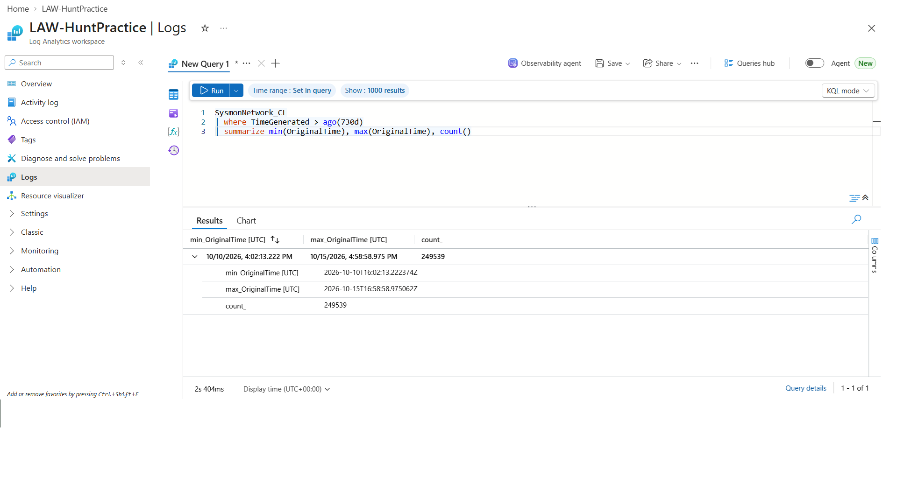

\---

**### 2. Searched the SysmonNetwork_CL Table for the Flagged Traffic**

**\*\*Flags answered (Section 1: The Outbound Anomaly):\*\***

\| Flag | Answer |

\|---|---|

\| The suspicious process | \`svchost1.exe\` |

\| C2 domain | \`egravy.com\` (*\*platform\**, reference query below) |

\| C2 addresses | \`5.182.33.151\`, \`185.196.9.213\` |

\| Transport channel | port \`80\` |

Grouped all connections from the host by process and destination, so repeated behavior would stand out. The busiest process was **\*\*not\*\*** the guilty one: \`svchost.exe\` in \`System32\` had 3,792 connections to \`10.1.10.4\` on port 3389 (RDP), but those were inbound (\`Initiated\` = false). The suspicious rows were a process named \`svchost1.exe\` running from the user's **\*\*Downloads\*\*** folder, connecting to two external IPs on port 80. The real \`svchost.exe\` lives in \`System32\`, so the extra \`1\` and the path gave it away. The summary also shows \`powershell.exe\` making 28 connections to \`8.8.8.8\` on port 53 (\`dns.google\`). I did not investigate it; it is probably normal DNS lookups from the lab's scheduled scripts, but that is unverified.

**\*\*Query used to locate events:\*\***

\`\`\`kql

SysmonNetwork_CL

\| where TimeGenerated > ago(730d)

\| where Computer == "NL-WS01"

\| where OriginalTime between (datetime(2026-10-15 10:00:00) .. datetime(2026-10-15 17:00:00))

\| summarize Connections = count(), FirstSeen = min(OriginalTime), LastSeen = max(OriginalTime)

    by Image, DestinationIp, DestinationHostname, DestinationPort

\| sort by Connections desc

\`\`\`

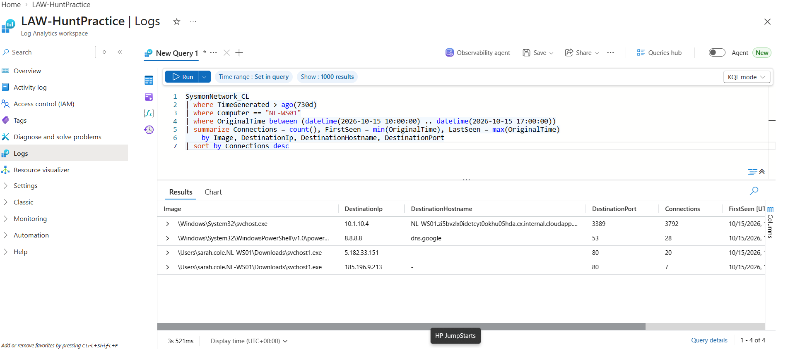

Confirmed the raw events for the suspicious process: 27 connections, all outbound (\`Initiated\` = true), all as \`NL-WS01\sarah.cole\`, from 10:07:54 to 16:46:33 UTC at irregular intervals, which is consistent with beaconing.

**\*\*Query used to confirm:\*\***

\`\`\`kql

SysmonNetwork_CL

\| where TimeGenerated > ago(730d)

\| where Computer == "NL-WS01"

\| where Image has "svchost1"

\| where OriginalTime between (datetime(2026-10-15 10:00:00) .. datetime(2026-10-15 17:00:00))

\| project OriginalTime, User, Image, Initiated, DestinationIp, DestinationPort, ProcessGuid

\| sort by OriginalTime asc

\`\`\`

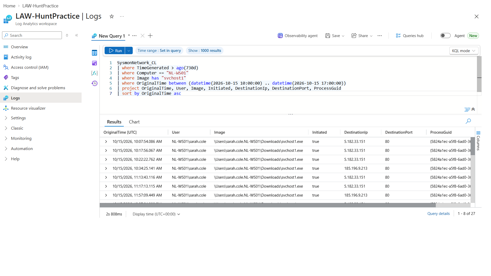

**\*\*Reference query for the C2 domain\*\*** (column names in \`SysmonDNS_CL\` are assumed; run \`getschema\` first):

\`\`\`kql

SysmonDNS_CL

\| where TimeGenerated > ago(730d)

\| where Computer == "NL-WS01"

\| where OriginalTime between (datetime(2026-10-15 10:00:00) .. datetime(2026-10-15 17:00:00))

\| where QueryName has "egravy"

\| project OriginalTime, Image, QueryName, QueryResults

\| sort by OriginalTime asc

\`\`\`

\---

**### 3. Checked How the Process Arrived and How the Attacker Got In**

**\*\*Flags answered (Sections 2 and 3, answers from the platform's case file):\*\***

\| Flag | Answer |

\|---|---|

\| Delivery application | Microsoft Edge |

\| Execution timestamp | \`2026-10-15 10:07:52\` UTC |

\| Session context | \`2\` (terminal session ID) |

\| Process legitimacy | Not legitimate |

\| Attacker source | \`187.15.135.77\` |

\| Attacker platform | Kali Linux |

\| Legitimate workstation | \`DESKTOP-AMOL2RQ\` |

\| Brute force | No |

A real \`svchost.exe\` is a Windows service host that lives in \`System32\`. A copy named \`svchost1.exe\` that runs from Downloads and talks to external IPs is masquerading. The delivery application and the execution time come from the platform. The Netflix email is a possible lure, but I found no evidence linking it to the download. For the attacker's access, the platform states a valid account was used from an external IP with no brute force. The window holds 3,071 failed logons (4625) overall, so "no brute force" has to be checked per source IP.

**\*\*Reference queries\*\*** (run these and add screenshots; they were not run as separate steps during the hunt):

\`\`\`kql

SysmonProcess_CL

\| where TimeGenerated > ago(730d)

\| where Computer == "NL-WS01"

\| where OriginalTime between (datetime(2026-10-15 10:00:00) .. datetime(2026-10-15 11:00:00))

\| where Image has "svchost1"

\| project OriginalTime, User, TerminalSessionId, Image, ParentImage, CommandLine

\`\`\`

\`\`\`kql

SysmonFileCreate_CL

\| where TimeGenerated > ago(730d)

\| where Computer == "NL-WS01"

\| where OriginalTime between (datetime(2026-10-15 09:00:00) .. datetime(2026-10-15 11:00:00))

\| where TargetFilename has "svchost1"

\| project OriginalTime, Image, TargetFilename

\`\`\`

\`\`\`kql

SecurityEvent_CL

\| where TimeGenerated > ago(730d)

\| where Computer contains "NL-WS01"

\| where OriginalTime between (datetime(2026-10-15 10:00:00) .. datetime(2026-10-15 17:00:00))

\| where IpAddress == "187.15.135.77"

\| project OriginalTime, EventID, LogonType, TargetUserName, IpAddress, Workstation

\| sort by OriginalTime asc

\`\`\`

\---

**### 4. Searched the SysmonProcess_CL Table for the Operator's Commands**

**\*\*Flags answered (Section 4: Hands on Keyboard):\*\***

\| Flag | Answer |

\|---|---|

\| Operator tell | \`ls\` |

\| Alternative escalation tool | \`SecEdit.exe\` |

\| Escalation proof | No (see step 5) |

\| Operator method | Human, typing live |

Pulled every \`cmd.exe\` and \`powershell.exe\` process from the first execution onward. Most of the 169 rows were noise: \`NT AUTHORITY\SYSTEM\` scheduled PowerShell scripts in \`\Windows\Temp\\\` and Azure guest agent processes that repeat on fixed schedules. The operator's activity was \`NL-WS01\sarah.cole\`, terminal session 2, running \`cmd.exe /c \<command>\`.

**\*\*Query used to locate events:\*\***

\`\`\`kql

SysmonProcess_CL

\| where TimeGenerated > ago(730d)

\| where Computer == "NL-WS01"

\| where OriginalTime between (datetime(2026-10-15 10:07:00) .. datetime(2026-10-15 17:00:00))

\| where Image has_any ("cmd.exe", "powershell.exe")

\| project OriginalTime, User, TerminalSessionId, Image, ParentImage, CommandLine

\| sort by OriginalTime asc

\`\`\`

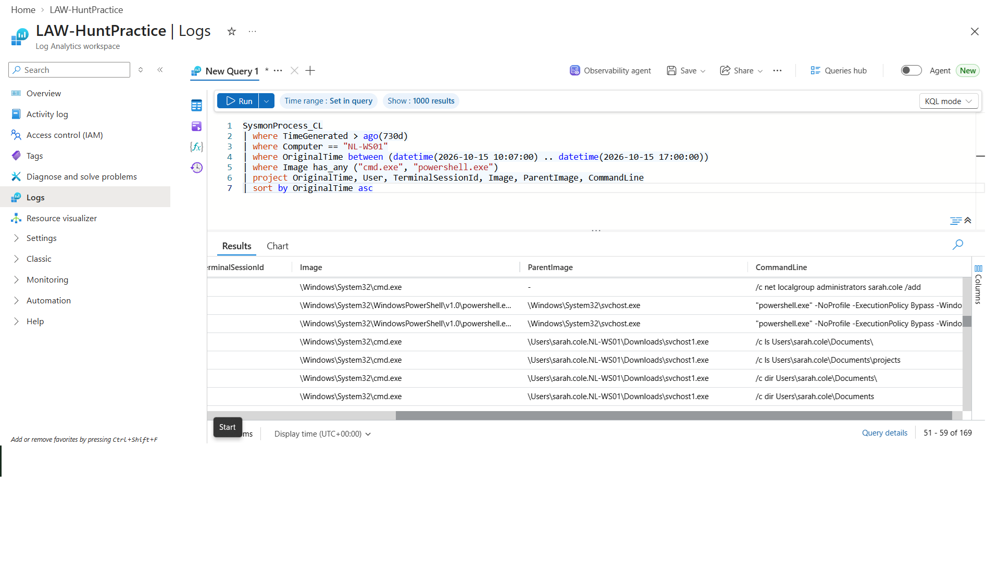

The screenshot shows rows 51 to 59 of 169 (scrolled right so the commands are visible). Reading down: the corrected \`net localgroup administrators sarah.cole /add\` (no parent process logged), two scheduled \`powershell.exe\` rows from \`NT AUTHORITY\SYSTEM\` (the noise), then \`ls\` twice and \`dir\` twice, all started by \`svchost1.exe\`.

**\*\*Why a human:\*\*** the operator typed the Linux command \`ls\` on Windows (12:20:48 and 12:21:15), then switched to \`dir\` at 12:21:36. They also mistyped \`net localgroups administrator sarah.cole/add\` at 12:15:35 and corrected it at 12:16:40. Commands came 13 to 19 seconds apart, then a 69 second gap, not a fixed interval like the SYSTEM scripts. That the \`ls\` calls failed is inferred from the switch to \`dir\`; Sysmon logs process starts, not error messages.

**\*\*Query used to confirm the alternative escalation tool:\*\***

\`\`\`kql

SysmonProcess_CL

\| where TimeGenerated > ago(730d)

\| where Computer == "NL-WS01"

\| where OriginalTime between (datetime(2026-10-15 10:00:00) .. datetime(2026-10-15 17:00:00))

\| where Image has "secedit" or CommandLine has "secedit"

\| project OriginalTime, User, Image, ParentImage, CommandLine

\`\`\`

At 14:01:35 the chain was the beacon (\`svchost1.exe\`), then \`cmd.exe\`, then \`\Windows\System32\SecEdit.exe\`, 24 milliseconds apart, with \`/configure ... /areas USER_RIGHTS\`.

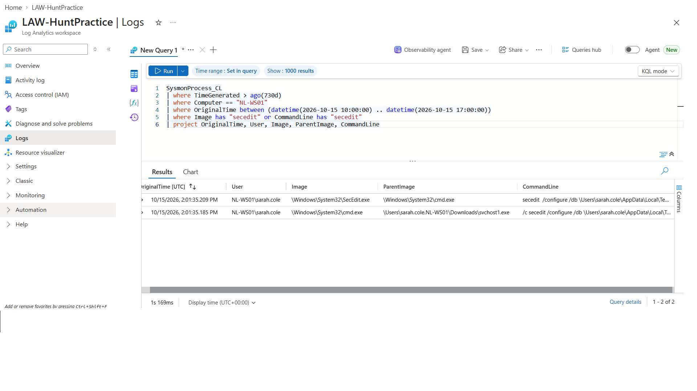

\---

**### 5. Searched the SecurityEvent_CL Table to See Whether Escalation Worked**

**\*\*Flag answered:\*\*** Did any privilege escalation attempt succeed? **\*\*No.\*\***

Event 4732 means a user was added to a security group, and event 4704 means a user right was assigned. Before searching for them, I listed every event ID for the host so an empty result would mean something.

**\*\*Query used to locate events:\*\***

\`\`\`kql

SecurityEvent_CL

\| where TimeGenerated > ago(730d)

\| where Computer contains "NL-WS01"

\| where OriginalTime between (datetime(2026-10-15 10:00:00) .. datetime(2026-10-15 17:00:00))

\| summarize Events = count() by EventID

\| sort by Events desc

\`\`\`

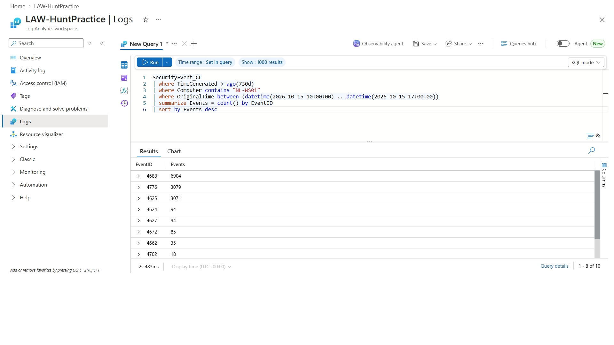

The host had 13,396 events across 10 event IDs (4688, 4776, 4625, 4624, 4627, 4672, 4662, 4702, 4634, 4648). **\*\*Neither 4732 nor 4704 appeared\*\***, so none of the three attempts (two \`net localgroup\` commands and \`secedit\`) succeeded. Event 4672 is a different event (special privileges at logon), not a rights assignment. Absence of events is strong evidence, not absolute proof.

\---

**### 6. Searched for What the Operator Accessed and Took**

**\*\*Flags answered (Section 5: What They Came For):\*\***

\| Flag | Answer |

\|---|---|

\| Credential file | \`passwords.txt\` |

\| Legitimate access time | \`10:01:54 UTC\` |

\| Exfiltration command | \`download\` |

\| Exfiltrated files | \`passwords.txt\`, \`vpn-access-notes.txt\` |

\| Staging before exfiltration | No |

**\*\*Query used to find every use of the credential file\*\*** (no host or time filter, so an earlier open could not be missed):

\`\`\`kql

SysmonProcess_CL

\| where TimeGenerated > ago(730d)

\| where CommandLine contains "passwords.txt"

\| project OriginalTime, Computer, User, TerminalSessionId, Image, ParentImage, CommandLine

\| sort by OriginalTime asc

\`\`\`

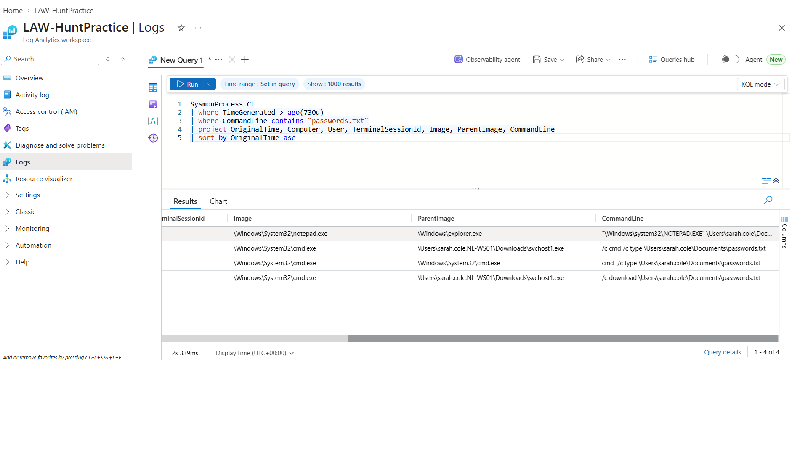

Four rows mention \`passwords.txt\` (the screenshot is scrolled to the right to show the process and command columns; the time column is off-screen):

\| Row | Image | Parent | Command line | Meaning |

\|---|---|---|---|---|

\| 1 | \`notepad.exe\` | \`explorer.exe\` | \`NOTEPAD.EXE ...\Documents\passwords.txt\` | The user double-clicked the file. At **\*\*10:01:54\*\***, about 6 minutes before the malware ran. |

\| 2 | \`cmd.exe\` | \`svchost1.exe\` | \`/c cmd /c type ...\passwords.txt\` | The attacker displayed the file (14:01:10). |

\| 3 | \`cmd.exe\` | \`cmd.exe\` | \`cmd /c type ...\passwords.txt\` | The same \`type\` command, one level down (inferred to be part of the same action as row 2). |

\| 4 | \`cmd.exe\` | \`svchost1.exe\` | \`/c download ...\passwords.txt\` | The attacker's \`download\` command (14:02:17). |

The account and session were the same, so the **\*\*parent process\*\*** is what told the user's access (\`explorer.exe\`) apart from the attacker's (\`svchost1.exe\`).

The operator ran \`download\` on two files: \`passwords.txt\` at 14:02:17 and \`vpn-access-notes.txt\` at 14:03:06. \`download\` is not a Windows command, so it is most likely a C2 framework command passed through to \`cmd.exe\` (inferred). Row 4 above is direct evidence for the first one. \`Client-Contacts.csv\` and \`Board-Meeting-Oct2026.docx\` were only displayed with \`type\` (14:03:41 and 14:04:02), but anything displayed in the session was still seen by the attacker. The logs show the commands being issued, not that each transfer completed.

**\*\*Reference query for every \`download\`\*\*** (not run as a separate step):

\`\`\`kql

SysmonProcess_CL

\| where TimeGenerated > ago(730d)

\| where Computer == "NL-WS01"

\| where OriginalTime between (datetime(2026-10-15 10:00:00) .. datetime(2026-10-15 17:00:00))

\| where CommandLine has "download"

\| project OriginalTime, Image, ParentImage, CommandLine

\| sort by OriginalTime asc

\`\`\`

**\*\*Query used to check for staging\*\*** (archive tools and copy/move commands):

\`\`\`kql

SysmonProcess_CL

\| where TimeGenerated > ago(730d)

\| where Computer == "NL-WS01"

\| where OriginalTime between (datetime(2026-10-15 10:00:00) .. datetime(2026-10-15 17:00:00))

\| where Image has_any ("7z", "7za", "winrar", "rar", "zip", "tar", "compress", "xcopy", "robocopy")

    or CommandLine has_any ("Compress-Archive", "7z", "rar", "zip", "tar", "compress", "xcopy", "robocopy", "copy", "move", "cp", "mv")

\| where User !has "SYSTEM"

\| project OriginalTime, User, Image, ParentImage, CommandLine

\| sort by OriginalTime asc

\`\`\`

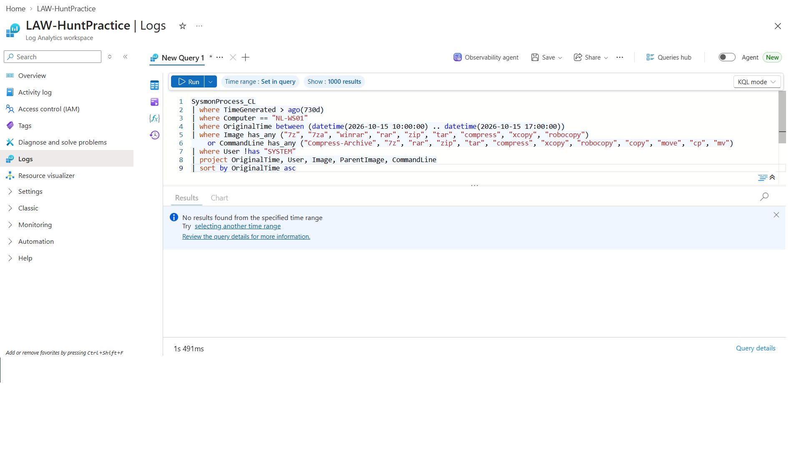

It returned **\*\*0 rows\*\*** on a host and window that held thousands of process events, so the empty result is real. The operator read files and sent them directly. The query excluded \`SYSTEM\` and matches whole terms, so the finding is "no evidence of staging".

\---

**### 7. Searched for Persistence**

**\*\*Flags answered (Section 6: The Second Skin):\*\***

\| Flag | Answer |

\|---|---|

\| Persistent beacon | \`imageloader.exe\` |

\| Hiding directory | \`picture-loader\` |

\| Cleanup evidence | \`sishelper.exe\` |

\| Registry value | \`image\` |

\| Naming pattern | Deliberate |

The operator's commands pointed at two file names (\`sishelper.exe\` and \`imageloader.exe\`), so I checked what was actually written to disk.

**\*\*Query used to locate events:\*\***

\`\`\`kql

SysmonFileCreate_CL

\| where TimeGenerated > ago(730d)

\| where Computer == "NL-WS01"

\| where OriginalTime between (datetime(2026-10-15 14:30:00) .. datetime(2026-10-15 17:00:00))

\| where TargetFilename has_any ("sishelper", "imageloader", "picture-loader")

\| project OriginalTime, Image, TargetFilename

\| sort by OriginalTime asc

\`\`\`

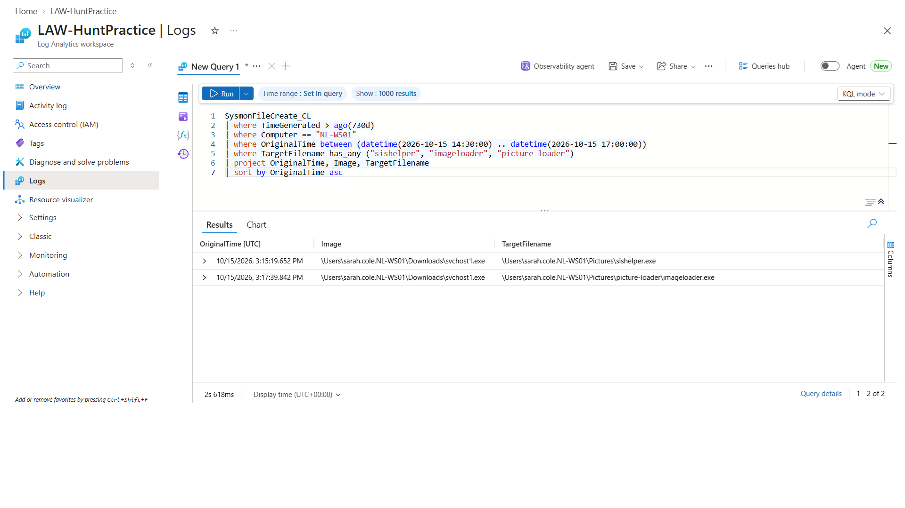

The beacon (\`svchost1.exe\`) wrote \`Pictures\sishelper.exe\` at 15:15:19 and \`Pictures\picture-loader\imageloader.exe\` at 15:17:39. In between, the operator ran \`del /f /q ...\Pictures\sishelper.exe\` (15:15:54) and \`mkdir ...\Pictures\picture-loader\` (15:17:05). Then, at 15:19:16, the operator wrote the autostart entry:

\`\`\`

reg add "HKCU\Software\Microsoft\Windows\CurrentVersion\Run" /v "image" /t REG_SZ /d "\Users\sarah.cole.NL-WS01\Pictures\picture-loader\imageloader.exe" /f

\`\`\`

\`/v "image"\` is the value name, and \`/d\` is the program that starts at the next logon of that user. The folder, file and registry value all share one image-viewer theme (\`Pictures\`, \`picture-loader\`, \`imageloader.exe\`, \`image\`), which suggests the names were chosen on purpose to look harmless. One thing I could not explain: the \`upload\` command named \`...\AppData\sishelper.exe\` as the destination, but the file-creation event shows it in \`\Pictures\\\`.

**\*\*Reference query to confirm the registry write\*\*** (column names assumed; run \`getschema\` first):

\`\`\`kql

SysmonRegistryEvent_CL

\| where TimeGenerated > ago(730d)

\| where Computer == "NL-WS01"

\| where OriginalTime between (datetime(2026-10-15 15:00:00) .. datetime(2026-10-15 17:00:00))

\| where TargetObject has "CurrentVersion\\\Run"

\| project OriginalTime, EventType, Image, TargetObject, Details

\| sort by OriginalTime asc

\`\`\`

\---

**### 8. Checked for Lateral Movement and Final Status**

**\*\*Flags answered (Section 7: What the Network Missed):\*\***

\| Flag | Answer |

\|---|---|

\| Lateral movement | No |

\| Root cause | RDP (Remote Desktop Protocol) |

\| Threat status | Not contained |

\| Priority remediation | Delete the \`image\` value from the \`HKCU\Software\Microsoft\Windows\CurrentVersion\Run\` registry key so that \`imageloader.exe\` no longer launches at logon. |

**\*\*Query used to locate events:\*\***

\`\`\`kql

SysmonNetwork_CL

\| where TimeGenerated > ago(730d)

\| where Computer == "NL-WS01"

\| where OriginalTime between (datetime(2026-10-15 10:00:00) .. datetime(2026-10-15 17:00:00))

\| where Image has_any ("svchost1", "imageloader", "sishelper")

\| extend Internal = ipv4_is_private(DestinationIp)

\| summarize Connections = count() by Image, DestinationIp, DestinationPort, Initiated, Internal

\| sort by Connections desc

\`\`\`

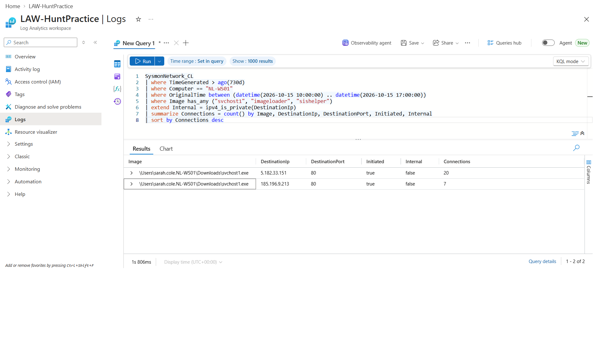

Only the two external C2 IPs appeared (20 and 7 connections, \`Internal\` = false). The persistent copy made no connections in the window. The earlier \`10.1.10.4:3389\` row is inbound RDP from the real \`svchost.exe\`, so it does not count. Sysmon may not record a blocked attempt, so the finding is "no evidence of lateral movement".

**\*\*Root cause:\*\*** inbound connections on port 3389 (RDP), and the platform states a valid account was used from \`187.15.135.77\` with no brute force. Linking that IP to the 3389 traffic is my inference until the logon query in step 3 is run.

**\*\*Threat status:\*\*** the beacon connected again at 16:46:33 UTC, about 14 minutes before the window closed, and the Run value was still in place. No containment action appears in the data. Deleting the Run value breaks persistence, but it does not stop the beacon that is already running.

\---

**## Chronological Event Timeline**

**### 1. Legitimate Access - passwords.txt**

\- **\*\*Timestamp:\*\*** \`2026-10-15T10:01:54Z\`

\- **\*\*Event:\*\*** The user \`sarah.cole\` opened \`passwords.txt\` in Notepad by double-clicking it.

\- **\*\*Action:\*\*** Process creation detected (parent \`explorer.exe\`).

\- **\*\*File Path:\*\*** \`C:\Users\sarah.cole\Documents\passwords.txt\`

**### 2. Malicious Process Execution**

\- **\*\*Timestamp:\*\*** \`2026-10-15T10:07:52Z\`

\- **\*\*Event:\*\*** \`svchost1.exe\` was executed from the Downloads folder (delivered through Microsoft Edge, per the platform).

\- **\*\*Action:\*\*** Process creation detected.

\- **\*\*File Path:\*\*** \`C:\Users\sarah.cole.NL-WS01\Downloads\svchost1.exe\`

**### 3. First C2 Beacon**

\- **\*\*Timestamp:\*\*** \`2026-10-15T10:07:54Z\`

\- **\*\*Event:\*\*** The first outbound connection to \`5.182.33.151\` on port \`80\` was made. The beacon kept connecting until \`16:46:33Z\`.

\- **\*\*Action:\*\*** Connection success (27 connections in total to two IPs).

\- **\*\*Process:\*\*** \`svchost1.exe\`

**### 4. Reconnaissance**

\- **\*\*Timestamp:\*\*** \`2026-10-15T10:10:00Z\` to \`2026-10-15T10:12:13Z\`

\- **\*\*Event:\*\*** The operator ran basic system and account discovery commands.

\- **\*\*Command:\*\*** \`hostname\`, \`ipconfig /all\`, \`net user\`, \`net localgroup administrators\`, \`net share\`, \`systeminfo\`

**### 5. Failed Group-Modification Attempts**

\- **\*\*Timestamps:\*\***

  - \`2026-10-15T12:15:35Z\` - \`net localgroups administrator sarah.cole/add\` (typo)

  - \`2026-10-15T12:16:40Z\` - \`net localgroup administrators sarah.cole /add\` (corrected)

\- **\*\*Event:\*\*** The operator tried to add \`sarah.cole\` to the local administrators group. No event 4732 was logged.

**### 6. Wrong-OS Command**

\- **\*\*Timestamp:\*\*** \`2026-10-15T12:20:48Z\`

\- **\*\*Event:\*\*** The operator typed the Linux command \`ls\`, then switched to \`dir\` at \`12:21:36Z\`.

\- **\*\*Command:\*\*** \`cmd /c ls Users\sarah.cole\Documents\\\`

**### 7. Sensitive Files Read**

\- **\*\*Timestamps:\*\*** \`2026-10-15T14:00:27Z\` to \`2026-10-15T14:04:02Z\`

\- **\*\*Event:\*\*** The operator displayed \`vpn-access-notes.txt\`, \`passwords.txt\`, \`Client-Contacts.csv\` and \`Board-Meeting-Oct2026.docx\` with \`type\`.

\- **\*\*Action:\*\*** Process creation detected (parent \`svchost1.exe\`).

**### 8. Second Escalation Attempt**

\- **\*\*Timestamp:\*\*** \`2026-10-15T14:01:35Z\`

\- **\*\*Event:\*\*** The operator tried to apply a security template with \`secedit\`. No event 4704 was logged.

\- **\*\*Command:\*\*** \`secedit /configure /db ...\cfg.db /cfg ...\security.inf /areas USER_RIGHTS\`

**### 9. Exfiltration**

\- **\*\*Timestamps:\*\***

  - \`2026-10-15T14:02:17Z\` - \`download \Users\sarah.cole\Documents\passwords.txt\`

  - \`2026-10-15T14:03:06Z\` - \`download \Users\sarah.cole\Documents\projects\vpn-access-notes.txt\`

\- **\*\*Event:\*\*** Two files were transferred to the attacker through the C2 channel.

**### 10. Persistent Copy Deployed**

\- **\*\*Timestamps:\*\***

  - \`2026-10-15T15:14:41Z\` - \`upload /home/kali/havoc/load/svchost.exe ...\sishelper.exe\`

  - \`2026-10-15T15:15:19Z\` - \`sishelper.exe\` written to \`\Pictures\\\`

  - \`2026-10-15T15:15:54Z\` - \`sishelper.exe\` deleted

  - \`2026-10-15T15:17:05Z\` - folder \`picture-loader\` created

  - \`2026-10-15T15:17:39Z\` - \`imageloader.exe\` written to \`picture-loader\\\`

\- **\*\*File Path:\*\*** \`C:\Users\sarah.cole.NL-WS01\Pictures\picture-loader\imageloader.exe\`

**### 11. Registry Persistence**

\- **\*\*Timestamp:\*\*** \`2026-10-15T15:19:16Z\`

\- **\*\*Event:\*\*** The operator added the Run value \`image\` so \`imageloader.exe\` starts at the next logon.

\- **\*\*Command:\*\*** \`reg add "HKCU\Software\Microsoft\Windows\CurrentVersion\Run" /v "image" ... /f\`

**### 12. Last Observed Beacon**

\- **\*\*Timestamp:\*\*** \`2026-10-15T16:46:33Z\`

\- **\*\*Event:\*\*** The last connection from \`svchost1.exe\` was seen, still active near the end of the hunt window.

\---

**## Indicators of Compromise**

\- **\*\*Files:\*\*** \`svchost1.exe\` (Downloads), \`imageloader.exe\` (\`Pictures\picture-loader\\\`), \`sishelper.exe\` (deleted)

\- **\*\*Registry:\*\*** \`HKCU\Software\Microsoft\Windows\CurrentVersion\Run\`, value \`image\`

\- **\*\*C2 IPs:\*\*** \`5.182.33.151\`, \`185.196.9.213\` (port 80)

\- **\*\*C2 domain:\*\*** \`egravy.com\`

\- **\*\*Attacker logon source:\*\*** \`187.15.135.77\` (Kali Linux)

\- **\*\*Exposed service:\*\*** RDP, TCP 3389

**## MITRE ATT&CK Mapping**

\| Technique | ID | Source |